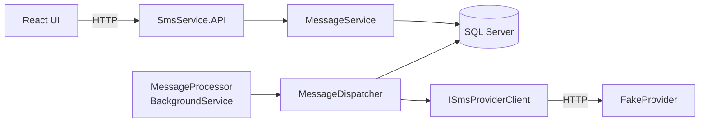
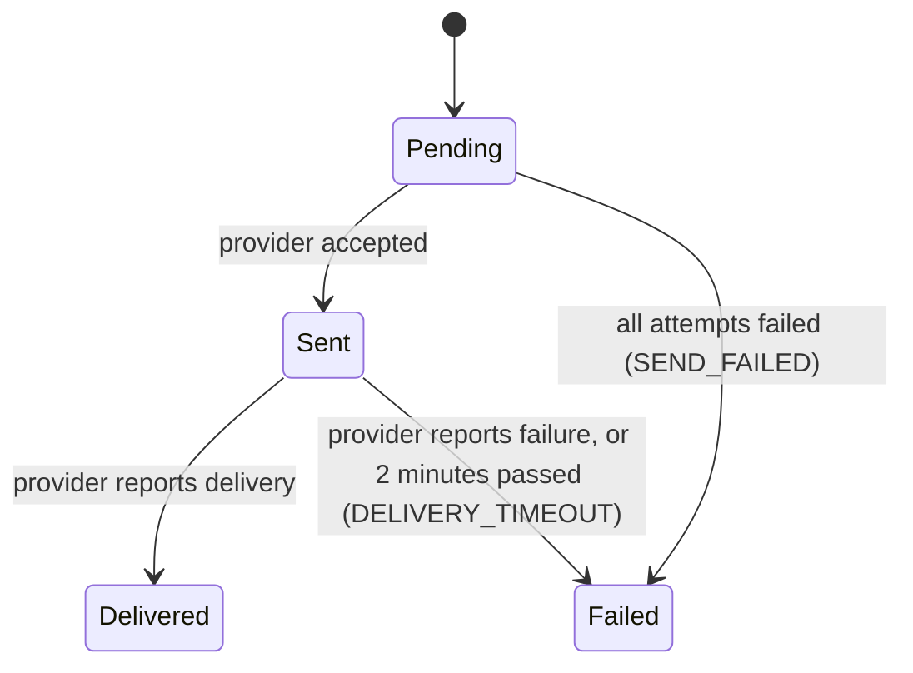

# Design: SMS Service for Employees

This document describes the final design, as implemented. Where the design changed during the work, the relevant decision number is given (see `decisions.md`).

## 1. Architecture

A layered solution on .NET 9 with Controllers (decisions 36, 37, 51):

| Project | Responsibility |
|---|---|
| `SmsService.Domain` | Entities: `Employee`, `Phone`, `Message`, `MessageStatus`, failure reasons |
| `SmsService.DTO` | API contracts and error codes |
| `SmsService.Application` | Business logic: `MessageService`, `EmployeeService`, `MessageDispatcher`. Interfaces: `IAppDbContext`, `ISmsProviderClient` |
| `SmsService.Infrastructure` | EF Core (`AppDbContext`, Migrations, seed), `SmsProviderClient` (HttpClient), `MessageProcessor` (BackgroundService) |
| `SmsService.API` | Controllers, error handling (ProblemDetails), Swagger UI |
| `SmsService.FakeProvider` | Fake SMS provider (separate process) |
| `SmsService.Tests` | xUnit + Moq + EF Core InMemory |
| `client/` | React + TypeScript + Vite 5 (decisions 52, 55) |

The business logic depends only on interfaces. `MessageDispatcher` talks to `ISmsProviderClient`, not to HTTP, so a different provider is a new implementation of that interface.

## 2. Data model (Code First)

| Entity | Fields | Constraints |
|---|---|---|
| `Employee` | Id, FirstName, LastName, Address | Unique index on the three fields |
| `Phone` | Id, EmployeeId, Number | FK to Employee. Non-unique index on Number |
| `Message` | Id (Guid), PhoneId, Body, Status, FailureReason, ProviderMessageId, IdempotencyKey, CreatedAt, UpdatedAt | FK to Phone (no snapshot, decision 38). Filtered unique index on IdempotencyKey (`IS NOT NULL`). Index on Status |

`Status` is stored as a string: `Pending`, `Sent`, `Delivered`, `Failed`.

## 3. API

| Endpoint | Description | Responses |
|---|---|---|
| `GET /employees` | Employees with phones (`phoneId`, `number`), phones ordered by Id. An employee without phones has an empty list | 200 |
| `POST /messages` | Body `{ phoneId, body }`, optional header `Idempotency-Key` | 202 `{ id, status }`. 400 `VALIDATION_ERROR` / `PHONE_NOT_FOUND` |
| `GET /messages/{id}` | A single message | 200 / 404 `MESSAGE_NOT_FOUND` |
| `GET /messages?status=` | Newest first, up to 100 | 200 / 400 `INVALID_STATUS_FILTER` |

**Message shape:** `id`, `status`, `body`, `createdAt`, `updatedAt`, `failureReason`, `employee` (`firstName`, `lastName`, `address`), `phoneNumber`.

**Errors:** `ProblemDetails` (RFC 7807) with an extra `code` field. Failure reasons stored on the message: `SEND_FAILED`, `DELIVERY_TIMEOUT`.

**Idempotency:** an existing key returns `202` with the same message, without comparing the body (decision 45).

**Swagger UI:** `/swagger`, Development only (decision 58).

## 4. Send flow

1. `POST /messages` validates, stores `Pending` and returns `202`.
2. `MessageProcessor` runs a cycle every 2 seconds and calls `MessageDispatcher.RunCycleAsync`.
3. **Send:** each `Pending` message is sent with only the phone number and body. Up to 3 attempts. Transient errors (network, timeout, 5xx) are retried after 1s and then 2s. Non-transient errors (4xx) are not retried. Success: `Sent` and `ProviderMessageId` saved. Failure: `Failed` / `SEND_FAILED`.
4. **Poll:** each `Sent` message is checked with the provider. `Delivered` or `Failed`. If 2 minutes passed since `CreatedAt` without a final status: `Failed` / `DELIVERY_TIMEOUT`. If the poll itself fails: log a warning and keep the status.

**Fake provider contract** (our assumption, decisions 6, 47):
- `POST /send` with `{ to, body }` returns `202 { providerMessageId }`.
- `GET /status/{providerMessageId}` returns `{ status }`: `Sent`, and `Delivered` after 3 seconds.
- A number ending with `0000` is always `Failed`. Messages are kept in memory only.

## 5. Error handling

| Situation | Behaviour |
|---|---|
| Unknown `phoneId` | 400 `PHONE_NOT_FOUND`, nothing stored |
| Validation failed (including malformed JSON) | 400 `VALIDATION_ERROR` |
| Unknown message id | 404 `MESSAGE_NOT_FOUND` |
| Invalid status filter (including numeric values) | 400 `INVALID_STATUS_FILTER` |
| Provider call fails | Up to 3 attempts, 5 second timeout, then `Failed` / `SEND_FAILED` |
| Status poll fails | Warning logged, retried next cycle |
| Double click | `Idempotency-Key` returns the existing message. The UI also disables the button while sending |
| One cycle throws (e.g. DB error) | Logged. The background loop keeps running |

## 6. Configuration (`appsettings.json`)

- `ConnectionStrings:Default`: `Server=localhost;Database=SmsService;Trusted_Connection=True;TrustServerCertificate=True` (decision 57)
- `SmsProvider`: `BaseUrl` (`http://localhost:5100`), `TimeoutSeconds` (5)
- `MessageProcessing`: `PollIntervalSeconds` (2), `DeliveryTimeoutMinutes` (2), `MaxSendAttempts` (3), `RetryDelaysSeconds` (`[1, 2, 4]`)
- `ClientOrigin`: `http://localhost:5173` (CORS)

## 7. Testing strategy

22 unit tests (xUnit, Moq, EF Core InMemory, and a controllable clock):
- `MessageService`: valid request, unknown `phoneId`, body length 160/161, missing body or `phoneId`, invalid status filter, unknown message id.
- `MessageDispatcher`: send success (only number and body are sent), retry then success, 3 failures to `SEND_FAILED`, no retry on non-transient errors, `Delivered`/`Failed` from the provider, still `Sent` before the timeout, `DELIVERY_TIMEOUT`, poll failure keeps the status, final messages are not polled.

Not tested automatically: idempotency, seeder, integration with SQL Server (EF InMemory does not enforce SQL Server constraints).

## 8. Running

- `run.cmd`: checks prerequisites and ports, checks that SQL Server is running, builds, starts provider (5100), API (5000) and client (5173), and opens the UI and Swagger.
- `run.cmd server`: provider and API only, opens Swagger (decision 59).
- `Ctrl+C` stops all processes.
